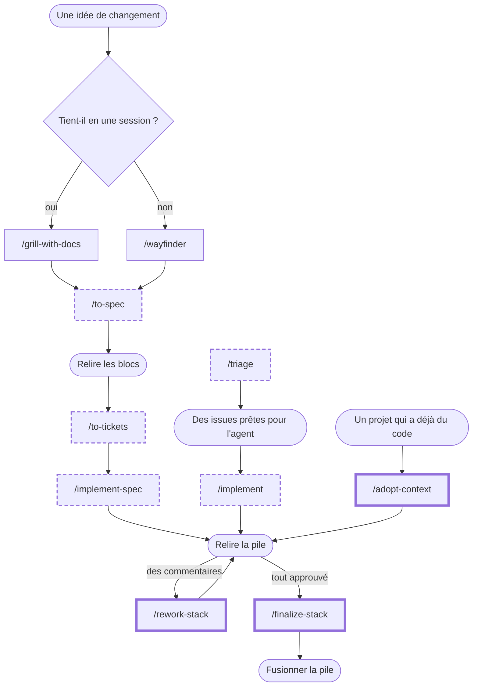

# charlouze-skills

Plugin de skills d'ingénierie pour Claude Code, qui se pose par-dessus [`mattpocock-skills`](https://github.com/mattpocock/skills) pour des projets produit et jeu vidéo. Il complète le flux de Matt par des consignes, sans le remplacer (voir [l'ADR 0004](docs/adr/0004-completer-matt-par-consignes.md)). Le dépôt est à la fois le plugin et sa marketplace.

## Le flux



Forme arrondie : une étape de l'humain ; rectangle : une commande que l'humain lance et que l'agent mène. Pour les rectangles, trait pointillé : une skill de Matt que le plugin complète ; trait épais : une skill que le plugin ajoute ; trait fin : une skill de Matt telle quelle.

- **`/grill-with-docs`**, quand le changement tient en une session (le cas par défaut) : la skill de Matt ; `domain-modeling`, qu'elle appelle, écrit le glossaire au format du plugin ([consigne](skills/setup-charlouze-skills/matt-files.md)).
- **`/wayfinder`**, quand il est trop gros pour une session et encore flou : la skill de Matt, dont la carte de décisions mène à la spec de changement ([Matt](https://github.com/mattpocock/skills)).
- **`/to-spec`** : les contextes touchés, l'écart en blocs, les risques et les grilles ([consigne](skills/setup-charlouze-skills/change-spec.md)).
- **Relire les blocs**, par l'humain : la spec de changement n'est publiée qu'une fois ses blocs et ses flags validés ([consigne](skills/setup-charlouze-skills/change-spec.md)).
- **`/to-tickets`** : chaque ticket nomme les blocs qu'il transcrit et tient seul une fois fusionné ([consigne](skills/setup-charlouze-skills/claude-md-block.md)).
- **`/implement-spec`** : une pile, une couche par ticket, chacune revue avant d'être poussée ([consigne](skills/setup-charlouze-skills/claude-md-block.md), [ADR 0003](docs/adr/0003-enchainement-parallele-empile-un-a-un.md)).
- **`/triage`**, lancée par l'humain, sans argument ou en nommant des tickets : trie seul ces tickets ou tous ceux à trier, sans attendre l'humain, et met en `needs-info`, avec des questions précises, ce qui demande sa préférence ; n'écrit que des labels, des commentaires et des fermetures ([consigne](skills/setup-charlouze-skills/claude-md-block.md)).
- **`/implement`**, lancée par l'humain en nommant au moins deux tickets sans spec de changement (des dérives, des bugs, de petites améliorations) : une pile, une couche par ticket, dans l'ordre que l'agent déduit ; avec un seul ticket, `/implement` reste celui de Matt ([consigne](skills/setup-charlouze-skills/claude-md-block.md), [ADR 0003](docs/adr/0003-enchainement-parallele-empile-un-a-un.md)).
- **`/adopt-context`**, lancée par l'humain sur un projet qui a déjà du code : l'adoption donne à un ou plusieurs contextes leur spec fonctionnelle, leur glossaire et leur ligne de carte, tirés des documents ou de l'humain, jamais du code, et ouvre une PR d'adoption sans code, avec une issue par dérive ([skill](skills/adopt-context/SKILL.md)).
- **Relire la pile**, par l'humain : chaque couche signale ses points d'attention et ses arbitrages ; les corrections s'ajoutent sans réécrire la pile ([politique d'historique git](skills/setup-charlouze-skills/git-history.md)).
- **`/rework-stack`**, lancée par l'humain à la fin d'une passe de revue : la reprise répond à chaque commentaire en attente de la pile, corrige les couches par des commits ajoutés, tient à jour les issues de dérive d'une PR d'adoption, puis redemande la revue ([skill](skills/rework-stack/SKILL.md)).
- **`/finalize-stack`**, lancée par l'humain : la finalisation fond les corrections sans changer le diff d'aucune couche ([skill](skills/finalize-stack/SKILL.md)).
- **Fusionner la pile**, par l'humain : `gh stack merge <PR du sommet> --merge`, ou `gh pr merge <PR> --merge` pour une PR seule, un merge commit par pile ([ADR 0002](docs/adr/0002-merge-commit-apres-finalisation.md)).

## Installation

```
claude plugin marketplace add anthropics/claude-plugins-official
claude plugin marketplace add charlouze/charlouze-skills
claude plugin install charlouze-skills@charlouze-skills --scope project
```

Lancez-les dans un terminal à la racine du dépôt : `--scope project` inscrit le plugin dans les réglages du projet, et chaque collaborateur lance l'installation une fois.

La première commande ne sert que si Claude Code ne connaît pas encore la marketplace de `mattpocock-skills`, dont le plugin dépend.

Puis, dans une session du projet : `/setup-matt-pocock-skills`, puis `/setup-charlouze-skills`. La mise en place montre chaque changement avant de l'écrire, ne commite rien, se relance sans risque et finit par ce qui reste à faire.

Le plugin n'a pas de version : chaque fusion sur `main` en fait une.

## Ce que le plugin apporte

| Skill | Ce qu'elle fait, ou ce que le plugin y change | Lancée par | Détail |
|---|---|---|---|
| `setup-charlouze-skills` | Prépare le dépôt : ses consignes, ses déclarations et ses réglages GitHub, dont `docs/agents/models.md`, le modèle et l'effort des subagents de grille et d'exploration. | l'humain | [skill](skills/setup-charlouze-skills/SKILL.md), [fichier des modèles](skills/setup-charlouze-skills/models-file.md) |
| `grid-review` | Juge par les grilles du projet un brouillon de spec de changement ou un diff, aux trois points d'accroche, et un brouillon d'adoption au point spec, avec le modèle que déclare le projet. | `/to-spec`, `/adopt-context`, `code-review` | [skill](skills/grid-review/SKILL.md), [ADR 0001](docs/adr/0001-grilles-axe-de-revue-separe.md) |
| `writing-functional-specs` | Donne la forme et les invariants d'une spec fonctionnelle. | `/to-spec`, `/adopt-context` | [skill](skills/writing-functional-specs/SKILL.md) |
| `adopt-context` | Adopte des contextes d'un projet qui a déjà du code : leur spec fonctionnelle, leur glossaire et leur ligne de carte, puis une PR d'adoption et ses issues de dérive. | l'humain | [skill](skills/adopt-context/SKILL.md) |
| `rework-stack` | Reprend les commentaires de revue d'une pile : répond à chacun, corrige les couches sans réécrire l'historique et suit les issues de dérive d'une PR d'adoption. | l'humain | [skill](skills/rework-stack/SKILL.md) |
| `finalize-stack` | Finalise une pile approuvée, avant que l'humain la fusionne. | l'humain | [skill](skills/finalize-stack/SKILL.md) |
| `to-spec` (Matt) | Ajoute à la spec de changement ses contextes, son écart en blocs et ses risques. | l'humain | [consigne](skills/setup-charlouze-skills/change-spec.md) |
| `to-tickets` (Matt) | Fait nommer à chaque ticket les blocs qu'il transcrit. | l'humain | [consigne](skills/setup-charlouze-skills/claude-md-block.md) |
| `implement-spec` (Matt) | Livre la spec de changement en une pile, une couche par ticket, et lance son exploration avec le modèle que déclare le projet. | l'humain | [consigne](skills/setup-charlouze-skills/claude-md-block.md), [ADR 0003](docs/adr/0003-enchainement-parallele-empile-un-a-un.md) |
| `implement` (Matt) | Livre plusieurs tickets nommés en une pile, une couche par ticket, dans l'ordre qu'il déduit, comme `implement-spec`. | l'humain | [consigne](skills/setup-charlouze-skills/claude-md-block.md), [ADR 0003](docs/adr/0003-enchainement-parallele-empile-un-a-un.md) |
| `code-review` (Matt) | Joint à chaque revue l'axe Grilles de `grid-review`. | l'humain, `/implement-spec` ou `/implement` | [consigne](skills/setup-charlouze-skills/claude-md-block.md) |
| `domain-modeling` (Matt) | Écrit le glossaire au format du plugin, et la carte des contextes. | `/grill-with-docs` | [consigne](skills/setup-charlouze-skills/matt-files.md) |
| `triage` (Matt) | Trie seul les tickets en attente, et met en `needs-info` ce qui demande l'humain. | l'humain | [consigne](skills/setup-charlouze-skills/claude-md-block.md), [dérives](skills/setup-charlouze-skills/matt-files.md) |
| `pr` (Matt) | Ajoute au corps d'une couche ses arbitrages et ses vérifications manuelles. | `/implement-spec` ou `/implement` | [consigne](skills/setup-charlouze-skills/claude-md-block.md) |

Les grilles par défaut ([déclaration](skills/grid-review/default-grids.md)) sont des skills de wondelai, que le plugin ne requiert pas.

## Pour aller plus loin

- [Le glossaire](GLOSSARY.md), les termes du plugin.
- [Les ADR](docs/adr/), le pourquoi du flux.
- [Contribuer](CONTRIBUTING.md) : développer le plugin, le valider, lancer ses tests.
